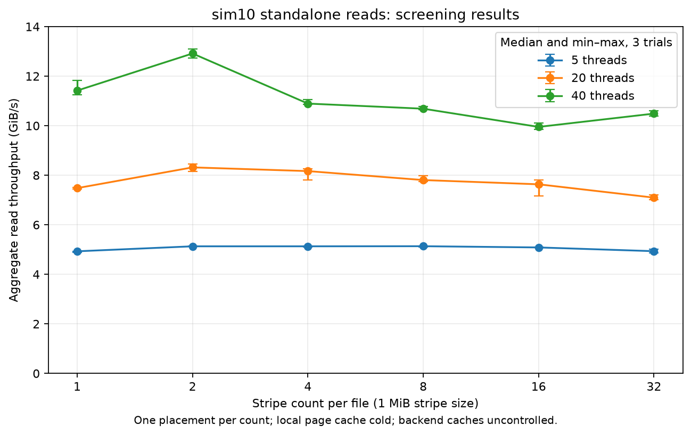

# sim10 stripe-count screening results

Job **61119210 completed successfully**, including all Slurm steps, on
`lcls_g/gpu_premium`, node `nid001940`. All **54/54 trials passed** the independent
receipt audit. It ran November 10, 2026, **4:36:51–6:24:51 PM PST**
(November 11, 00:36:51–02:24:51 UTC), taking **1 hour 48 minutes**.

Two stripes had the highest median throughput at 20 and 40 threads. At 40
threads, count 2 reached **12.92 GiB/s**, versus **11.42 GiB/s** at count 1;
the block-paired geometric mean improvement was **12.30%**. At 20 threads,
count 2 reached **8.32 GiB/s**, with an **11.18%** paired improvement. At 5
threads, all counts were within 5% of the best median (count 8, 5.13 GiB/s).
The 5-thread cases may be limited by single-thread client CPU: in the count-1,
block-0 sample, worker CPU time was 80–89% of elapsed time. This suggests a
client-side limit, not a proven bottleneck, and weak discrimination among stripe
counts at this concurrency.

The original selection rule retains **counts 1, 2 and 4** for confirmation:
count 1 is the baseline, and counts 2 and 4 lead the pooled geometric mean of
nine paired ratios per count (three thread counts × three blocks). The ratios
are shown below. Count 8's best 5-thread median is only 0.07% above count 2,
with overlapping observed ranges; this is not treated as a distinct
concurrency-specific win requiring an extra finalist.

These are confirmation candidates, not a final optimum. Only one placement of
each stripe count was tested. The next experimental phase would compare
independently placed copies of these three counts; it has not been launched.

Values are aggregate GiB/s over all five files. Parentheses show min–max across
three randomized blocks, not confidence intervals. Each cell read all
335,820,951,264 bytes; fixed 1 MiB requests and 1 MiB stripe size were used.

| Stripes | 5 threads | 20 threads | 40 threads |
|---:|---:|---:|---:|
| 1 | 4.93 (4.88–4.93) | 7.48 (7.44–7.51) | 11.42 (11.26–11.83) |
| 2 | 5.13 (5.11–5.14) | 8.32 (8.15–8.46) | 12.92 (12.74–13.09) |
| 4 | 5.13 (5.10–5.13) | 8.17 (7.80–8.26) | 10.89 (10.86–11.05) |
| 8 | 5.13 (5.09–5.15) | 7.81 (7.75–7.98) | 10.69 (10.65–10.77) |
| 16 | 5.09 (5.08–5.11) | 7.63 (7.17–7.82) | 9.95 (9.86–10.12) |
| 32 | 4.93 (4.86–5.02) | 7.10 (7.00–7.20) | 10.49 (10.38–10.59) |

Block-paired geometric mean throughput ratio versus count 1 at the same
concurrency (three ratios, one per block):

| Stripes | 5 threads | 20 threads | 40 threads |
|---:|---:|---:|---:|
| 1 | 1.0000 | 1.0000 | 1.0000 |
| 2 | 1.0436 | 1.1118 | 1.1230 |
| 4 | 1.0420 | 1.0804 | 0.9507 |
| 8 | 1.0427 | 1.0495 | 0.9307 |
| 16 | 1.0360 | 1.0082 | 0.8674 |
| 32 | 1.0043 | 0.9501 | 0.9120 |

Pooled geometric mean of all nine ratios, following PLAN step 3:

| Stripes | Pooled ratio versus count 1 |
|---:|---:|
| 1 | 1.0000 |
| 2 | 1.0922 |
| 4 | 1.0229 |
| 8 | 1.0061 |
| 16 | 0.9676 |
| 32 | 0.9547 |

The audit rechecked all raw reader and eviction receipts, schedule, full byte
coverage, disjoint ranges, timing, CPU binding, binary identity, memory records,
current input identities/layouts, and successful Slurm accounting. Coordinator
checks additionally byte-compared all execution sources to reviewed commit
`aca91d45230b3aa18a69f2472e16eebf2f177375` and matched the exact allocated node.
The production binary SHA256 is
`b4195c36d1694ae540e7ff1843ac772f95ae3749973eae6a8172906ba4309485`.
No benchmark execution source changed after review round 2.

All 30 files were evicted before each case; participating files additionally
passed the immediate local-page-cache gate. This establishes local cache state,
not physical remote storage traffic. Server/backend caches and background
filesystem contention were uncontrolled. Lustre counters were unavailable;
exact readahead limit values were not captured. Core/NUMA placement was recorded,
but this is one node and one CPU placement policy. Pilot results from a different
node are excluded. No psana or GPU processing was measured.

Actual campaign allocation time so far is 8,807 node-seconds (2.446 hours):
2,089 staging + 238 pilot + 6,480 screening, within the 12-node-hour budget.
This is allocation time, not premium billing units or an updated account balance.

Evidence: [independent audit](sweep/audit.json), [all trials CSV](sweep/trials.csv),
[Slurm accounting](sweep/accounting-utc.txt),
[exact source/node acceptance](sweep/coordinator-acceptance.json), and
[raw artifact index with original paths and hashes](sweep/artifact-index.json).
All 54 raw outputs and their companion receipts are copied byte-for-byte into
`sweep/` for independent review. Original artifacts remain at
`/pscratch/sd/m/monarin/psana2-gpu/sim10-striping-20261110/reader-sweep01`.

Independent native-result review round 3 **passed** evidence commit
`f687d0e2bf1c910e786e9a4e151aab7e61b9330e`, with all required reads successful
and no blocking findings. See [review](review-03.json) and
[responses](responses-03.md). The user approved the external review after the
initial automatic approval block. Implementation review round 2 passed the
execution commit above. Subsequent changes only record review closure and the
non-blocking finalist/CPU-limit clarifications; execution sources and native
evidence are unchanged.
