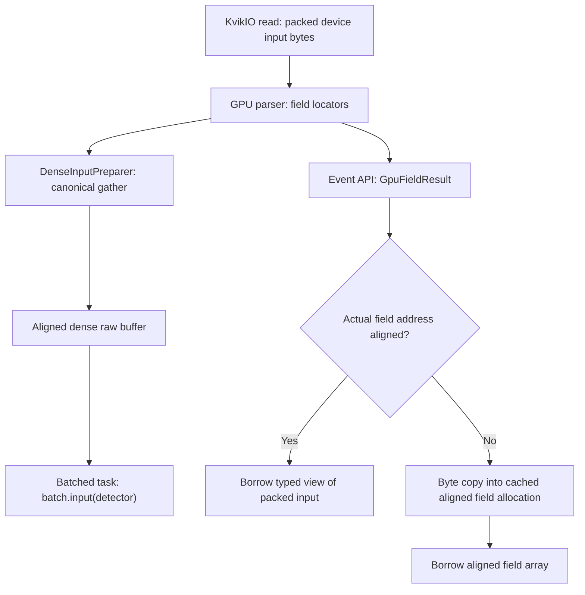

# Issue 159: call paths, buffers, and event lifetime through Stage 4

**Scope update — October 29:** this remains a historical Stage 4 walkthrough.
The [revised Stage 5 plan](issue159_stage5_revised_plan_20261029.md) supersedes
its former direct-byte D2H proposal. Stage 5 now verifies existing accessor
compatibility and documents costs; direct D2H optimization is deferred.

This walkthrough describes the implementation on `fix/gpu-unaligned-reads-159`
through runtime commit `ef0a453d4`, using the integrated PR #187 base
`90c05965c`. Stage 2 makes the dense gather safe, Stage 3 retains field-copy
storage through asynchronous consumers, and Stage 4 supplies safe public field
views. The formerly proposed direct-byte `.on_cpu` optimization is not present
and is no longer required by Stage 5.

The main result is that packed XTC bytes stay unchanged. We neither insert zero
padding into the input nor reject an otherwise valid field because its address
is unaligned. We fix the two read paths where alignment matters.

## 1. Start with the buffers

Suppose KvikIO has loaded an event's XTC bytes into device input storage. A
parser locator identifies a field by byte offset, byte count, type, shape, and
status. That field can reach a user through two separate paths:



| Storage | Purpose | Lifetime owner |
| --- | --- | --- |
| Packed device input | Original XTC bytes read by KvikIO | Parsed input window and its registered uses |
| Dense raw buffer | Canonical event/segment/pixel layout for supported dense detectors | Preparer backing associated with an execution slot |
| Aligned field copy | Safe typed access to one unaligned event field/segment | Event's root input lease, plus allocation ownership retained by aliases |
| Independent `.on_gpu` result | Device array the caller can keep | Caller-owned CuPy allocation |
| Independent `.on_cpu` result | NumPy array the caller can keep | Returned CPU data / field's CPU cache |

**The public field API does not read the dense raw buffer.** It still resolves
fields from the parsed input, which supports scalars, arbitrary fields, absent
segments, and differing segment shapes. Stage 4 adds a field-sized aligned
allocation on that path only when needed.

In the original two-read model, Stage 2 fixes the packed-input load performed
by the gather. The gather's output already has aligned dense storage. Stage 4
fixes public field access that bypasses the gather and otherwise exposes a
typed view of the original packed input.

## 2. Pipeline call path before user access

The controller path is in [gpu_events.py](../gpu_events.py). In outline:

```text
GpuEventManager._issue_gpu_read()
  per-dgram: gpu_reader.issue_batch()
  bulk/group: _issue_group_reads()
    -> group inputs issue reads and reserve their storage

GpuEventManager._wait_gpu_read()
  -> wait_batch() or group read completion

GpuEventManager._submit_gpu()
  -> _submit_per_dgram_gpu() or _submit_group_gpu()
  -> EventPool.submit()
     -> parse an input window, or receive already parsed group windows
     -> acquire execution input uses; wait for window readiness
     -> construct GpuEventDgrams for the selected events
     -> DenseInputPreparer.prepare_batch(), where requested
     -> dispatch_task(), where configured
     -> record result_ready on the execution stream
     -> create an InputSlotLease for each event
     -> bind its dgrams to that lease
```

Bulk mode can share a parsed input window across multiple executions. The
per-event lease is therefore a reference to the relevant input owner, not
ownership inferred from an execution slot number. This window/use architecture
was inherited from the integrated base; our fix builds on it.

The Stage 4 change in [EventPool.submit](../gpu_stream.py) passes the pool's
existing finalized budget into each event's `InputSlotLease`. It does not create
a separate field-copy budget.

## 3. Stage 2: safe loads inside the existing dense gather

The dense path is:

```text
EventPool.submit()
  -> DenseInputPreparer.prepare_batch()
     -> obtain/reuse dense data and presence buffers
     -> _GatherMap.prepare()
     -> _CanonicalGatherPlan.gather()
        -> _batched_gather_kernel(dtype)
  -> BatchInputContext.input(detector)
  -> user's batched task / kernel
```

See [gpu_detector.py](../gpu_detector.py) and
[BatchInputContext](../gpu_task_batch.py). The kernel continues validating
locator status, type, rank, dimensions, and bounds. Invalid/missing rows retain
the existing zero-data and zero-presence behavior.

The new decision is inside the same kernel:

```text
field_address = input_base_address + locator_offset
if field_address is aligned for the element type:
    use the original typed load
else:
    load individual bytes and reconstruct the element's bits
write the element into the aligned dense output
```

For example, take a `uint16` field at address `0x1001`, with bytes `34 12` in
hexadecimal. A typed 16-bit load at that odd address is unsafe. The fallback
reads the two bytes and computes `0x34 | (0x12 << 8)`, giving `0x1234`. It writes
that value into the existing dense output. The float32 fallback reconstructs
four bytes as integer bits and uses `__uint_as_float`, preserving the bit
pattern rather than numerically converting the integer.

This adds no alignment scratch buffer, preliminary padding pass, or extra
kernel launch. Both paths perform the same gather into the existing output.
The current canonical gather supports `uint16` and `float32`; this is distinct
from the broader numeric-type support of public field views.

Actual-address alignment matters here. If a sliced input base is `0x1001` and
the field offset is 8, offset divisibility would incorrectly say a float32
field is aligned. The actual address is `0x1009`, which is unaligned. Conversely,
base `0x1001` plus offset 3 gives aligned address `0x1004`.

## 4. Stage 4: an event-loop field request

For a configured detector named `jungfrau`, the user-facing call path is:

```text
evt.gpu.detector("jungfrau")
  -> GpuEventState.detector()
  -> GpuDetectorEvent
     .field("raw", "raw", segment=9)
       -> GpuFieldResult
          .on_gpu_view(user_stream)
            -> _GpuFieldViewContext.__enter__()
               -> acquire child input lease
               -> user_stream.wait_event(result_ready)
               -> GpuFieldResult._slot_views(user_stream)
```

See [context.py](../context.py) and [gpu_input.py](../gpu_input.py).
Detector and segment names in examples must match the experiment's Configure.

On first access, `_slot_views()` obtains the locator row, validates it, and
checks `(source.data.ptr + offset) % dtype.itemsize`. The locator readiness is
synchronized and its small metadata row may be copied to the CPU to resolve
shape/type. This public event API is not a promise of synchronization-free
access. The batched dense gather does not perform that locator-row D2H.

For aligned input, `_slot_views()` returns a typed slice/reshape of the original
bytes. There is no new device allocation or payload copy for alignment.

For unaligned input, `_materialize()`:

1. Looks for an existing copy in the root event lease, keyed by
   `(detector, algorithm, field, physical segment)`.
2. Allocates aligned storage with `owned_empty(..., category='field-copy')`.
3. Retains that allocation on the root lease **before** submitting GPU work.
4. Submits one byte-oriented D2D `memcpyAsync` from the packed field address.
5. Records a copy-ready event and registers it with the lease.
6. Publishes the `(array, ready_event)` cache entry after successful submission
   and event recording.

The requesting stream waits for copy readiness. A later context on another
stream also waits for readiness; returning a cached pointer alone would not
be sufficient. Whole-field and single-segment requests share this cache within
the same event. Different events do not share field copies.

### Concrete field example

Suppose segment 9 contains a `(2, 3)` float32 field at base `0x1000` plus offset
1. Its 24 payload bytes start at `0x1001`.

- First access allocates a `(2, 3)` float32 array, for example at `0x8000`,
  and copies exactly 24 bytes. No leading zeros or XTC offset changes are used.
- A user kernel receives the aligned `0x8000` pointer.
- A second access to segment 9 during the same event uses that pointer and its
  readiness event, without another alignment copy.
- A whole-field request containing segment 9 reuses it too.

With the supported default CuPy pool, this 24-byte allocation consumes a
512-byte block. The pipeline charges **512 bytes once**, not 24 bytes per
access. [gpu_allocation.py](../gpu_allocation.py) attaches the charge to the
backing allocation so aliases keep it charged even after a cache is cleared.

A scalar keeps shape `()` and copies one dtype element. A zero-length field
keeps its zero-length shape and issues no payload memcpy. A `NOT_PRESENT`
segment is omitted and allocates nothing. Different present segments retain
their individual shapes rather than being implicitly stacked.

## 5. Stage 3: why the copy needs an independent lifetime

A Python cache alone cannot protect an asynchronous copy or kernel. Retirement
clears public field caches, but a user stream may still be reading the array.
Stage 3 therefore added root-lease retention separate from those caches.

Important fields in `InputSlotLease` are:

| State | Meaning |
| --- | --- |
| `_uses` | Reserved uses of the original parsed input windows |
| `_view_children` | Number of open borrowed-view child leases |
| `_retained_copies` | Strong references to field allocations, independent of public caches |
| `_copy_done` | Completion tokens that must finish before retained copies can be dropped |
| `_field_copies` | Stage 4 lookup cache for reusing an aligned field copy |

Copy-retention lists remain `None` until needed. Merely constructing an input
lease does not allocate device storage or a copy-specific CUDA event.

An open view forks input-window uses before exposing arrays. Its child points
to the root lease and shares its lock. The child count is maintained even when
the child was opened before the first field copy, so it protects later copies
too. This is a small extension to the existing input-lease design.

### Normal event-loop example

```python
# Illustrative fragment inside an existing configured run.
user_stream = cp.cuda.Stream(non_blocking=True)
for evt in run.events():
    field = evt.gpu.detector("jungfrau").field("raw", "raw", segment=9)
    with field.on_gpu_view(user_stream) as segments:
        panel = segments.only()
        with user_stream:
            consume_panel(panel)  # enqueue work on this same stream
    # Do not submit more work using panel after the context ends.
```

`consume_panel` represents the user's GPU operation. Passing `user_stream` to
`on_gpu_view` orders readiness and records completion on that stream; it does
not automatically switch the current stream for arbitrary code in the body.
Use `with user_stream:` or pass the stream explicitly to a kernel launch.

On context exit, `_GpuFieldViewContext.__exit__()` records a consumer-done event
after the user's work and transfers it through the child lease to the input
owner. Closing a context does not mean queued GPU work has already completed;
the completion token makes subsequent retirement safe. Exit or retirement can
block when draining is required.

The event manager exposes results through `_yield_ready()` during the pool's
retirement/delivery window. `begin_retire_next()` synchronizes the outgoing
producer stream; `finish_retire_next()` subsequently retires the leases before
releasing the execution record. It is not simply “free the input at the next
Python loop iteration”: a window can serve several events/executions, and its
uses and completion events decide when its backing becomes reusable.

### Open views when event retirement begins

The following is a lifetime example exercised by the regression tests, not a
recommendation to hold views across many events:

| Step | State and consequence |
| --- | --- |
| 1. Open a view on stream S1 | Child C1 reserves source-window uses. First unaligned access creates copy F and records copy-ready Ecopy. |
| 2. Open a view on stream S2 | Child C2 reserves uses, receives F, and waits for Ecopy. Both streams may enqueue readers. |
| 3. Parent event lease retires | New parent access is disabled; public view and field-copy lookup caches are cleared. C1/C2 still protect source storage, and root retention still holds F. |
| 4. C1 exits | Its consumer event is registered and its uses returned. F remains retained because C2 is open. |
| 5. C2 exits | Its consumer event is transferred too. Once the parent is closed and no children remain, `_release_copies()` waits for recorded completion before dropping the retained references. |
| 6. Window retirement completes | The closed input window releases its backing only after all its uses and readiness/consumer events permit it. Bulk/group windows may complete through deferred polling/draining. |

Retirement callbacks detach public access; they do not themselves prove CUDA
completion. Conversely, a caller accidentally keeping a CuPy alias can keep
its allocation and budget charge alive, but does **not** extend the public
borrowed-view API contract beyond the context.

An already-open context can finish using its returned arrays after parent
retirement starts. Opening a new context on a retired event is rejected as a
lifetime error. That is separate from alignment: a valid, live unaligned field
is now handled by copying rather than rejected.

## 6. Copy counts for the three public accessors

These counts are per present segment and describe payload copies, excluding
locator metadata and any earlier dense gather on the separate task path.

| Request | Aligned input | First unaligned access | Unaligned copy already cached |
| --- | --- | --- | --- |
| `on_gpu_view(stream)` | No payload copy | 1 D2D alignment copy | No new payload copy |
| `.on_gpu` | 1 D2D independent copy | 2 D2D copies: align, then independent copy | 1 D2D independent copy |
| First `.on_cpu` | 1 D2H copy | 1 D2D alignment copy + 1 D2H copy | 1 D2H copy |

`.on_gpu` internally enters `on_gpu_view` and calls `value.copy()` on the current
stream. Its returned arrays are independent of the input lease; the internal
alignment allocation remains pipeline-budgeted, while the independent result
is caller-owned storage outside the framework byte budget (and still consumes
device memory). Independent storage does not remove the caller's
normal responsibility for ordering later cross-stream work.

`.on_cpu` currently enters the same safe-view context and calls `value.get()`.
It caches independent NumPy values; subsequent `.on_cpu` accesses to that same
`GpuFieldResult` reuse the cache, including after event retirement if it was
populated beforehand. A segment-selected `GpuFieldResult` has its own host cache,
while sharing the matching aligned device copy on the root lease. First nonempty
CPU access blocks until its current-stream D2H transfer completes; cached or
empty access does not necessarily synchronize.

The former Stage 5 proposal to avoid the intermediate alignment D2D by copying
bytes directly to host storage is superseded by the October 29 compatibility
plan. The current safe path and the copy counts above remain the behavior to
verify; direct byte D2H is a deferred optimization.

The naming caveat we agreed to record is therefore explicit: **`on_gpu_view`
means borrowed access, not guaranteed zero-copy access.**

## 7. Failure handling and scope boundaries

If allocation fails, no memcpy is submitted and the allocation helper rolls
back its charge. If memcpy submission or readiness-event recording fails,
`_materialize()` retains the destination and registers the submitting stream
as a completion token before trying to drain it. A failed drain preserves
ownership for retry. A failed materialization is not published in the copy
cache. `_release_copies()` likewise keeps allocations if completion cannot be
confirmed.

These changes do not replace task field descriptors. `batch.field(detector,
algorithm, field)` still returns device metadata pointing into packed input.
A custom kernel consuming those descriptors must validate status/type/bounds
and handle actual-address alignment itself; it does not automatically pass
through `GpuFieldResult._materialize()`. `batch.input(detector)` is the distinct
dense, gathered path described above.

The changes also preserve the distinction between parsed-input field access
and published task outputs (`GPUResult`/output `SlotLease`). They do not redesign
PR #187 scheduling, input-group ownership, or output delivery.

## 8. What is implemented and verified

| Stage | Runtime change | Evidence |
| --- | --- | --- |
| 2 | Actual-address check and byte fallback in canonical gather | [Stage 2 report](issue159_stage2_20261019.md): bit-exact and alignment checks; aligned-path performance screen |
| 3 | Root/child retention and completion handling for field-copy storage | [Stage 3 report](issue159_stage3_20261019.md), [accepted warm screen](issue159_stage3_cache_reset_retry_20261020.md) |
| 4 | Actual-address field views, lazy aligned copies/cache, budget propagation | [Stage 4 report](issue159_stage4_20261021.md): 399 CPU, 323 CUDA and 305 memcheck checks passed |

Useful tests to read alongside this walkthrough:

- [Gather alignment](../../tests/gpu/integration/test_gather_alignment.py):
  aligned and unaligned loads, including shifted input bases.
- [Input-copy lifetime](../../tests/gpu/unit/test_gpu_input_copy_lifetime.py):
  root/child retirement, completion failures and retry behavior.
- [Field-view unit tests](../../tests/gpu/unit/test_gpu_field_views.py):
  validation, caching, shapes, budgets and injected failures.
- [Field-view device tests](../../tests/gpu/integration/test_gpu_field_views_device.py):
  typed loads, delayed producers, two consumer streams, copies surviving cleared
  caches, and the final release of source/copy storage.

Stage 4 performance acceptance is still open at this walkthrough's creation.
Screen **41602068** compares Stage 3 against Stage 4 with the unchanged staged
warm-cache gates. Cache warming concerns CPU file-cache preparation for that
benchmark; it is separate from these GPU-buffer alignment and lifetime changes.
