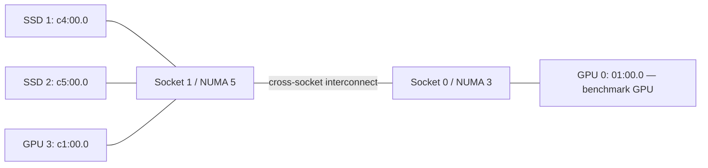

# Local scratch and NUMA: sdfampere012 versus sdfampere027

The nodes have **different local SSD hardware**, although their storage/GPU
NUMA attachments match. This is a concrete confounder in the historical
391-versus-177 Hz comparison, and the strongest explanation found so far for
most of that difference. It does not prove that every remaining difference is
hardware or clear all cumulative runtime changes.

Read-only inventory job **41630382** completed successfully on both nodes on
October 22. It used one CPU/1 GiB per node, took one second and did not benchmark
I/O, change settings, or touch another job's data.

## Measured hardware

| Property | sdfampere012 | sdfampere027 |
| --- | --- | --- |
| Benchmark | 40882509, October 16 | 41614567, October 22 |
| Post-stack revision | `410ebba1c` | `410ebba1c` |
| Cold bulk-off rate, 10000/median(loop_s) | 391.32 Hz | 177.17 Hz |
| Filesystem | XFS `/lscratch` on `/dev/md0` | Same |
| Array | 2-drive RAID0, 512 KiB chunks, about 14 TiB | Same |
| SSDs | 2 × Kioxia `KCM6XRUL7T68`, CM6-R, 7.68 TB | 2 × WD `WUS4BB076D7P3E3`, SN640, 7.68 TB |
| Firmware | `0106` | `R1110021` |
| Active PCIe link per SSD | **16 GT/s ×4 (Gen4)** | **8 GT/s ×4 (Gen3)** |
| SSD maximum link | 16 GT/s ×4 | 8 GT/s ×4 |
| SSD PCI addresses | `0000:c4:00.0`, `0000:c5:00.0` | Same |
| SSD NUMA/socket | **NUMA 5, socket 1** | Same |
| GPU 0 PCI address | `0000:01:00.0` | Same |
| GPU 0 NUMA/socket | **NUMA 3, socket 0** | Same |
| GPU 0 active PCIe link | 16 GT/s ×16 | Same |
| GPU 3 NUMA/socket | NUMA 5, socket 1 | Same |
| Array and SSD read-ahead | 4096 KiB | Same |
| SSD scheduler | `none` | Same |
| md0 maximum request size | 128 KiB | 512 KiB |
| SSD maximum request size | 128 KiB | 1280 KiB |
| Current kernel | `5.14.0-570.58.1.el9_6.x86_64` | Same |

The Gen3 link on 027 matches the SSD's own maximum; it is not evidence of a
Gen4-capable SSD accidentally negotiating down. Each SSD has its own ×4 root
port. Both machines expose eight NUMA nodes across two sockets: nodes 0–3 on
socket 0, nodes 4–7 on socket 1. The node-3/node-5 distance is 32, versus 10
for local memory and 12 for other nodes on the same socket. These firmware
numbers express relative distance, not a measured slowdown factor.

This diagram shows physical locality. Both benchmarks use KvikIO CPU fallback,
so payload passes through host memory; the actual page-cache/bounce-buffer NUMA
placement is not determined just by the device attachment.

## Why this fits the throughput gap

The [Kioxia CM6-R specification](https://www.kioxia.com/content/dam/kioxia/shared/business/ssd/enterprise-ssd/asset/productbrief/eSSD-CM6-R-product-brief.pdf)
rates the 7.68 TB model at up to 6,900 MB/s sequential reads. The
[WD SN640 specification](https://documents.sandisk.com/content/dam/asset-library/en_us/assets/public/western-digital/product/data-center-drives/ultrastar-nvme-series/data-sheet-ultrastar-dc-sn640.pdf)
rates the 7.68 TB model at up to 3,250 MB/s. Adding the two device ratings gives
13.8 GB/s versus 6.5 GB/s; these are nominal device-rating sums, not measured
RAID performance or guaranteed limits for this workload.

The benchmark reads 335.57176 GB per 10,000 events. Its effective payload rate
was **13.13 GB/s** on 012 and **5.95 GB/s** on 027. Dividing the nominal sums by
33.557176 MB/event gives about 411 versus 194 events/s before application
and filesystem overhead, consistent with the measured 391 versus 177 Hz.

Across all 16 cold samples on 027, saved node-wide disk-counter deltas show a
median **335.606 GB** read at md0 and **167.803 GB per SSD**. Both devices served
the data evenly. Median device I/O-busy time was about **56.3 s**; the surrounding
snapshot interval includes process startup/teardown and is about 63 s, while
the event loop is about 56.5 s. These counters support real cold disk reads;
I/O-busy time alone does not prove NVMe saturation. Equivalent historical
physical-disk counters were not saved for the 012 run.

**Inference:** the SSD model and PCIe generation difference can plausibly account
for most of the rate gap. NUMA binding has not been isolated experimentally.
The 012 SSD inventory was collected six days after its benchmark, so it is a
current hardware observation, not a recovered October 16 device manifest.
027's SSD models and RAID members also match its saved benchmark-time snapshot.

## What staging onto a different NUMA node means

The staged file lives on the RAID0 block device. Running the copying process on
a different CPU/NUMA node does not choose a different SSD or relocate that RAID's
PCIe connections. File blocks are striped across the two devices.

NUMA can change **RAM placement** and the cost of the CPU-fallback read path.
Page-cache pages and host buffers may be allocated near the CPU doing the work,
subject to memory policy and available memory; GPU 0 may then read host memory
across sockets. Linux documents the distinction between task memory policy,
page-cache allocation and existing pages in its
[NUMA memory policy guide](https://kernel.org/doc/html/v5.17/admin-guide/mm/numa_memory_policy.html).

For a warm run, the staging/prefill policy can leave substantial page-cache data
on particular NUMA nodes. For these cold runs, fsync/DONTNEED and a ≤1% per-file
residency gate occur before every timed sample. That removes almost all original
staging-cache placement from the measurement. NUMA still matters when the read
workers allocate new page-cache pages and pinned bounce buffers.

Both historical runs used broad CPU affinity and no rank binding. The actual
worker CPUs and per-process NUMA memory placement were not recorded. 012's
112-CPU mask excluded node 2's CPUs; 027's excluded node 4's. **Both included
NUMA 3 and NUMA 5**, so neither allocation excluded the GPU-local or SSD-local
CPUs. The fixed physical topology is the same; effective task/memory placement
may still vary.

## Consequences for comparisons

Use same-node A/B measurements and record SSD model, firmware, negotiated PCIe
speed/width and NUMA attachment. An A100 node name/partition alone does not imply
comparable cold-storage performance. The earlier incremental A/B results remain
usable; absolute rates from these unlike SSDs should not be treated as a
software regression by themselves.

The next direct check would replay the current frozen post-stack build and
harness on **012**, keeping GPU 0 and all existing settings. That would test
whether the fast rate returns with the faster storage under the current harness.
If NUMA needs isolation after that, compare controlled CPU/memory placement on
one fixed node, retaining four BDs and avoiding a misleading reduction to one
small NUMA node's CPU/memory capacity. GPU 3 is storage-local on both machines,
but switching to it is a separate experimental variable, not a silent fix.
The user subsequently authorized that replay. Job **41631223** was submitted
October 22 at 15:28 PDT, explicitly requesting **sdfampere012**. It is pending
resources at the submission check, with no scheduler start estimate. It reruns
the exact frozen 16-sample pre/post-stack screen from job 41614567; both A/B
builds remain separate and unchanged. This preserves the same schedule as 027
and includes the post-stack comparison of interest. GPU 0, cold gates, input
hashes, CPU/memory policy and all benchmark settings remain unchanged.

All **2,107** frozen hashes and the balanced schedule passed before submission.
Only the Slurm requested node and job name were overridden; the frozen batch
script was not edited. New output goes to `screen/job-41631223/` under the same
artifact root, with distinct job-named logs and private `/lscratch` copies.
No prior result is overwritten. Runtime may be shorter with the faster disks;
the previous identical screen took 44 minutes, and the allocation limit is
90 minutes. Queue time is unknown.

The comparison will report A/B means and sample standard deviations separately
for bulk off/on, and compare post-stack B against 027 and the historical 012
result. A recovery toward 391 Hz would support the storage-hardware explanation;
a continued ~177 Hz would require checking the remaining harness/build changes.
Even a successful replay would not isolate NUMA effects by itself.

Raw inventory:
`/sdf/scratch/users/m/monarin/gpu-validation/lscratch-numa-20261022-r1/`

[Compact topology and disk-counter evidence](evidence/lscratch_numa_012_027_20261022.json).
