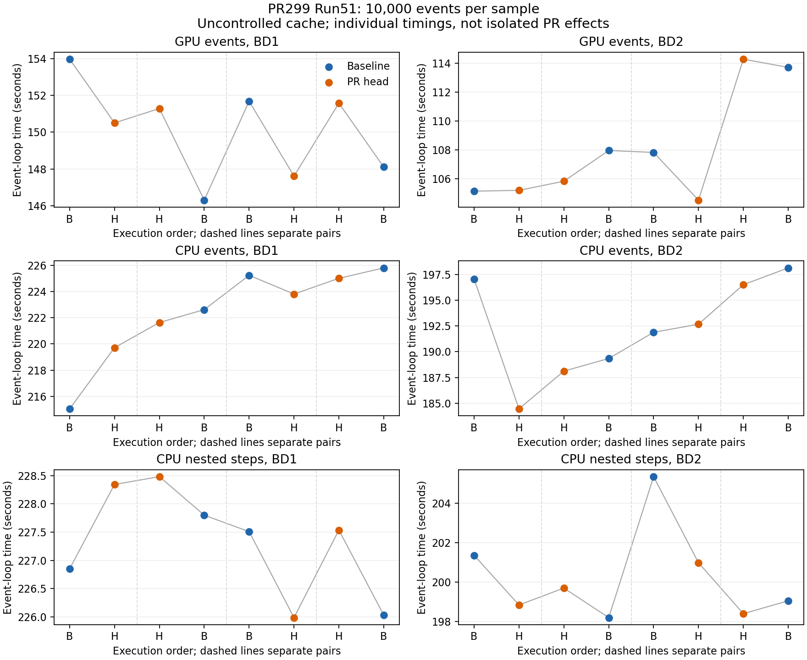

# PR299: completed Perlmutter Run51 performance screen

## Verdict and scope

**Accept the agreed Run51 performance follow-up; do not approve the PR for
merge on this evidence.** No consistent regression was demonstrated across
the six measured cases. Small PR effects remain inconclusive because of
paired spread, execution-order effects, and uncontrolled storage/cache state.
This is not a statistical equivalence test or a universal regression bound.

The measured comparison is exactly:

- Baseline: `11e4a13b541e2aefbfcb7168ab4d2040e2bcd4ba`.
- PR head: `acfd029a8d27898b5f165e02facd3c3bbc9c4ad2`.
- PR: <https://github.com/slac-lcls/lcls2/pull/299>.

The commit adding this archive is **not** the measured head. Neither these
results nor later evidence-only commits measure a subsequent C1-fixed revision.

## Execution and configuration

Job 61375111 on Perlmutter nid003260 completed with exit `0:0` in 02:44:14,
within the requested 04:03:00. Slurm allocated/billed a full four-GPU node;
each workload step used **one physical A100-SXM4-40GB**. BD1/BD2 mean one/two
BD workers sharing that GPU, plus one SMD0 and one EB, with eight disjoint
physical cores per rank. This was not a multi-node scaling test.

The 12 preflights used 120 events each. All 48 timed samples processed the
same first 10,000 of 17,872 available events from experiment mfx100848724,
Run51. Each of six cases has four adjacent pairs in B/H, H/B, B/H, H/B order.
The selected prefix contains one step and does not exercise EndRun.

| Setting | Value |
| --- | --- |
| GPU workload | Raw Jungfrau minimal task; calibration skipped; no full-image D2H |
| GPU streams | One per BD; two BDs share the physical GPU in BD2 |
| Batch / GPU budget | 20 events / 8 GB per BD |
| Reads | Bulk enabled, 1 MiB target; KvikIO compatibility ON (CPU fallback), no GDS |
| KvikIO | Four threads, 1 MiB tasks |
| CPU controls | Existing events and nested-steps iterator workloads, not equal-byte CPU/GPU speedup tests |
| Builds | Fresh local scratch release builds; optimization 3, debug false, LTO, ndebug true, C++20, build_daq false |
| Runtime | Python 3.9.20, GCC 14.3.0, CuPy 13.6.0, KvikIO 24.08.02, CUDA runtime 12.9 |
| MPI | Actually mapped Cray MPICH 9.0.1; module default was 9.1.0 |

## Paired results

Positive change means faster head: `100 * (head_events_per_second /
base_events_per_second - 1)`. The reported median is the median of four
paired ratios, not the ratio of median times. Ranges are observed pair
extrema, **not confidence intervals or equivalence bounds**.

| Case | Median change | Pair range | Median loop seconds, base / head |
| --- | ---: | ---: | ---: |
| GPU events BD1 | +0.00% | -3.28% to +2.75% | 149.89 / 150.89 |
| GPU events BD2 | +0.98% | -0.50% to +3.16% | 107.90 / 105.53 |
| CPU events BD1 | +0.40% | -2.12% to +0.64% | 223.92 / 222.72 |
| CPU events BD2 | +0.74% | -0.41% to +6.82% | 194.46 / 190.39 |
| CPU nested steps BD1 | -0.48% | -0.66% to +0.67% | 227.18 / 227.94 |
| CPU nested steps BD2 | +0.80% | -0.75% to +2.17% | 200.20 / 199.26 |

GPU BD1's head-second median is +2.52%, versus -2.79% head-first: a 5.31
percentage-point order gap hidden by its near-zero overall paired median.
Both GPU BD2 variants slow in the last pair. CPU events drift as well; CPU
BD2's first +6.82% pair is much larger than the other pairs.

Startup and MPI-process wall times are separate scopes. GPU BD1 max-rank
setup medians are 14.02 / 17.43 seconds; MPI-wall medians are 185.68 / 185.78.
Its *paired* MPI-wall throughput change has median -1.73%, ranging from
-10.47% to +4.81%. Event-loop acceptance is not startup/end-to-end equivalence.
Do not add medians of different timing scopes.

## Sustained execution and storage

All 16 timed GPU samples completed. BD1 last-half rates range from 66.58 to
69.17 events/s; last-three-quarter min/max rate ratios are 0.923 to 0.977.
BD2 per-worker last-half rates range from 43.36 to 51.13 events/s, with
quarter ratios 0.767 to 0.941. These are rank-local windows with different
endpoints, not rates that can simply be added. BD1 logs reach 10,000 events;
BD2 unlogged final tails are 0 to 80 events, covered by final sample counts.

Each timed GPU sample records 335,571,760,000 completed read bytes; the 16
samples total 5,369,148,160,000. Accounting sums disjoint reset windows and
final tails. It is not unique data volume, physical traffic, or isolated
I/O bandwidth. Sampled GPU peaks are 1,831 MiB (BD1) and 3,657 MiB (BD2),
not exact allocation high-water marks.

The 48 derived storage summaries contain 4,157 observations. Peak observed
job memory is 94.006 GB against a recorded 240.965 GB limit. Job
`memory.events` deltas are zero, but substantial scan/steal/refault counters
are present: **no OOM does not mean no reclaim**. Actual monitor intervals
span 2.262 to 2.366 seconds; mean of sample means is 2.310 seconds.
Lustre llite and memory PSI were unavailable. Network counters are node/client
observations, not process-attributed or necessarily Lustre traffic. There
was no staging, cache eviction, or cold-cache claim. Storage versus reclaim
cannot be separated causally from this evidence.

Completed sustained measurements replace the earlier SDF short-prefix
extrapolation. They do not diagnose or demonstrate resolution of the prior
SDF/Weka slowdown, and do not establish performance for other datasets,
multi-stream concurrency, calibration-heavy work, or GDS.

## Provenance, auditability, and qualifications

The reviewed manifest is
`1433a2107fd8dd6ec589ce4fc8863b78df39e45d1e933e2fbca8814f6ce1eabd`.
All 1,171 entries in the transferred source bundle passed checksum verification
before packaging. The archive mapping retains original paths and hashes for
every copied file; the package checksum list covers the relocated package.
Paths in the preserved `FINAL_REPORT.txt` refer to the original tree: its
review is relocated to `reviews/campaign-r1.json`, its snapshot to
`campaign-job-61375111/`, and the PDF plot is omitted (the PNG is retained).
These locations are relative to this note's evidence directory.

The compute guards checked the intended initial psana import/native prefixes,
hashes of loaded project libraries, rank placement, and GPU isolation.
MPI/CUDA/KvikIO runtime observations were repeated after work. The preserved
`FINAL_REPORT.txt` overstates this as psana import validation both before and
after: `verify_install()` is called **before** the workload only. This note
qualifies that historical wording without rewriting the original artifact.

All timed samples record the timestamp digest
`2034208363befd6a797f889cbbff997a4c28d7297cf136de15e6b775a0597f17`,
which matches the independent SMD reference. The harness checked event lists,
per-rank order, and step assignments before discarding those lists. Offline
verification checks the recorded digest/counts, not every discarded event.
Ten SMD hashes and bigdata metadata matched at execution; full payloads
were not hashed. Fresh-build and post-campaign frozen-check claims rely on
the retained execution/build records; build trees and inputs are not included.

The campaign-r1 review approved readiness, not the statistical result or
merge. Its optional end-time cross-check and mocked campaign-loop test remain
nonblocking follow-ups. The original missing QoS/balance evidence was later
archived; only the non-sensitive QoS output is included here, not account
balances or reviewer authentication/invocation records.

The compact archive preserves sample summaries, per-rank progress/runtime/I/O,
sampled GPU measurements, commands, and status. Raw `storage.jsonl`, full
worker/event arrays, source/build/install trees, data, and complete node
inventory are omitted. Storage rollups can be checked against per-sample
derived summaries, but cannot be regenerated from raw storage logs here.
The sizing approval digest is reconstructed using its original-tree hash
index and estimate, not by rehashing the omitted sizing payloads.

## Functional review remains separate

- **C1 remains blocking and unfixed at the measured head:** a returned CPU
  Step loses its events when its temporary `run.steps()` parent is released.
  Nested-loop timings retain the parent and do not exercise that regression.
- **Run77 remains deferred:** no local dataset was available for the GPU
  events-versus-steps multi-step/EndRun comparison. This is a coverage gap,
  not another newly confirmed defect.
- **R2 remains nonblocking:** document GPU parent-generator lifetime.
- **R1 remains nonblocking:** remove the identified trailing whitespace.
- Parser-cost optimization remains separate in issue #310.

No C1 fix, production-code change, new job, or external PR review is part of
this evidence package.

## Evidence and scripts

- [Frozen scripts and execution-layout guide](../scripts/pr299_perlmutter/README.md).
- [Paired CSV](evidence/pr299_perlmutter_20261115/plots/paired-timings.csv),
  [campaign summary](evidence/pr299_perlmutter_20261115/campaign-summary.json),
  [validation and sustained windows](evidence/pr299_perlmutter_20261115/campaign-validation.json).
- [Storage rollup](evidence/pr299_perlmutter_20261115/campaign-storage-rollup.json)
  and [per-sample storage/progress](evidence/pr299_perlmutter_20261115/campaign-storage-progress.json).
- [Manifest](evidence/pr299_perlmutter_20261115/manifest.json),
  [readiness review](evidence/pr299_perlmutter_20261115/reviews/campaign-r1.json),
  [compact samples](evidence/pr299_perlmutter_20261115/campaign-job-61375111/).
- [Original source checksums](evidence/pr299_perlmutter_20261115/SOURCE_SHA256SUMS),
  [archive mapping](evidence/pr299_perlmutter_20261115/archive-map.json), and
  [package checksums](evidence/pr299_perlmutter_20261115/SHA256SUMS).

Package checksums use repository-relative paths and exclude their own file.
`SOURCE_SHA256SUMS` refers to the larger original transfer, not to this subset.
